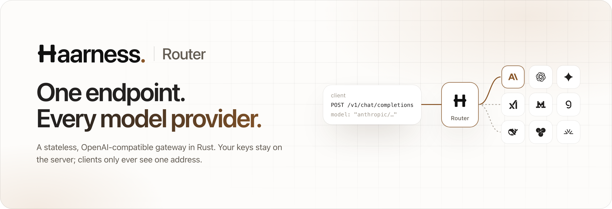
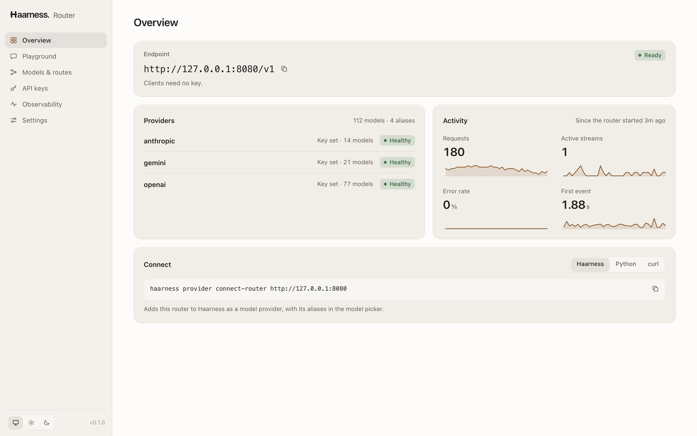

<p align="center">
  <a href="https://haarness.ai">
    <picture>
      <source media="(prefers-color-scheme: dark)" srcset=".github/assets/banner-dark.png">
      
    </picture>
  </a>
</p>

<p align="center">
  <a href="#quick-start"><b>Quick start</b></a>&nbsp;&nbsp;·&nbsp;&nbsp;<a href="docs/README.md"><b>Docs</b></a>&nbsp;&nbsp;·&nbsp;&nbsp;<a href="docs/configuration.md"><b>Configuration</b></a>&nbsp;&nbsp;·&nbsp;&nbsp;<a href="docs/security.md"><b>Security model</b></a>&nbsp;&nbsp;·&nbsp;&nbsp;<a href="docs/haarness.md"><b>Use with Haarness</b></a>&nbsp;&nbsp;·&nbsp;&nbsp;<a href="https://haarness.ai"><b>haarness.ai</b></a>
</p>

<p align="center">
  <a href="LICENSE"></a>
  
  
</p>

**Haarness Router is one OpenAI-compatible endpoint in front of every model provider you use.** Point any
OpenAI SDK at it and call OpenAI, Anthropic, Gemini (or Vertex AI), Amazon Bedrock, Groq, Mistral, xAI,
DeepSeek, Together, Fireworks or any OpenAI-compatible server by name, with aliases and fallback between
them. It is a single stateless Rust binary with a built-in dashboard, and it deliberately has **no billing,
user database, provider marketplace or prompt storage** — it routes, and that is all.

<p align="center">
  <picture>
    <source media="(prefers-color-scheme: dark)" srcset=".github/assets/web-ui-dark.png">
    
  </picture>
</p>

## Why Haarness Router

<table>
<tr>
<td width="50%" valign="top">

**Native adapters, not shims.** Anthropic Messages, Gemini GenerateContent, Bedrock Converse and OpenAI's
Responses API are spoken natively behind Chat Completions: tools, structured output, reasoning (thought
signatures included), images, PDFs, audio and video are translated, or refused with a 400 before any
upstream call.

</td>
<td width="50%" valign="top">

**Aliases and safe fallback.** `fast` can mean "this model, else that one". Targets are filtered by what
the request needs, and the router falls back only on connection failures or 408/429/5xx before the first
event, behind a per-target circuit breaker.

</td>
</tr>
<tr>
<td valign="top">

**Keys stay on the server.** Clients present an optional router key that is never forwarded; provider
credentials are read once from environment variables and are never returned or logged.

</td>
<td valign="top">

**Built for load.** Bounded bodies and SSE frames, connection and idle deadlines, backpressure and
cancellation on disconnect. A local ten-minute soak held 10,000 streams with 0 errors and a 4 ms p99
router-added first-chunk latency ([record](docs/records/2026-08-23-local-benchmark.md)).

</td>
</tr>
<tr>
<td valign="top">

**A dashboard in the same binary.** `/ui` shows provider health, models and routes, live metrics, a
playground and process-local router keys — nothing extra to deploy.

</td>
<td valign="top">

**Operable from day one.** Layered TOML with typed `--set` overrides validated before startup, Prometheus
metrics with bounded labels, one JSON log line per chat request, and request IDs you can correlate.

</td>
</tr>
</table>

## Quick start

There are no prebuilt binaries or container images yet: build it with a stable Rust toolchain (CI uses
1.94; the workspace declares 1.88 as its minimum).

```bash
git clone https://github.com/haarness/haarness-router && cd haarness-router
cp config.example.toml config.toml
export OPENAI_API_KEY='...' ANTHROPIC_API_KEY='...' GEMINI_API_KEY='...'
cargo run --release --bin haarness-router -- --config config.toml
```

Every provider in the file needs its key variable set, or startup stops and names the missing one. The
router listens on `127.0.0.1:8080`, with the dashboard at <http://127.0.0.1:8080/ui>. Call an exact model,
or the `fast` alias from the example configuration:

```bash
curl http://127.0.0.1:8080/v1/chat/completions \
  -H 'Content-Type: application/json' \
  -d '{"model":"openai/gpt-5-nano","messages":[{"role":"user","content":"Hello"}],"stream":true}'
```

Any OpenAI client works unchanged — see the [Python](examples/openai_python.py) and
[JavaScript](examples/openai_typescript.mjs) examples:

```python
import os
from openai import OpenAI

client = OpenAI(base_url="http://127.0.0.1:8080/v1", api_key=os.getenv("HAARNESS_ROUTER_KEY", "unused"))
client.chat.completions.create(model="fast", messages=[{"role": "user", "content": "Hi"}])
```

A self-hosted router accepts requests without a key by default. Before exposing it beyond loopback, start
it with `--require-key` (it then reads the key from `HAARNESS_ROUTER_KEY`) or set `[auth]`, and read the
[security model](docs/security.md).

## How it fits

```text
client  -- Authorization: Bearer <router key, optional> -->  haarness-router  -- provider credential -->  provider
                                                                  |
                                                  /ui dashboard · /metrics · /healthz
```

| Endpoint | What it does |
| --- | --- |
| `POST /v1/chat/completions` | Streaming and non-streaming Chat Completions, routed to an exact `provider/model` or an alias. |
| `GET /v1/models` | Configured aliases and models, plus live catalogs discovered from each provider (cached five minutes). |
| `GET /healthz`, `GET /readyz` | Unauthenticated health checks; both answer `{"status":"ok"}` while the process serves. |
| `GET /metrics` | Prometheus text; behind the router key (or a scrape-only token) when authentication is on. |
| `/ui` | The embedded dashboard; optional HTTP Basic protection, or `web_ui.enabled = false` to remove it. |

Configuration is one TOML file plus repeatable `--set`/`--unset` overrides and `--host`/`--port`/`--bind`;
values only *name* the environment variables that hold secrets. See [configuration](docs/configuration.md)
and the [API reference](docs/api.md).

**From Haarness**, connect the router by address — **Settings → Providers → Connect Haarness Router** in
Desktop, **/providers → Connect Haarness Router** in the terminal UI, or
`haarness provider connect-router http://127.0.0.1:8080` — and its models appear on their own. See
[Use with Haarness](docs/haarness.md).

## Workspace

| Crate | Role |
| --- | --- |
| `router-protocol` | The public OpenAI/OpenRouter-shaped request and response types. |
| `router-core` | Configuration, capabilities, authentication, routing, fallback and circuit breakers. |
| `router-providers` | The OpenAI-compatible, OpenAI Responses, Anthropic, Gemini and Bedrock adapters, SSE, PDFs and model discovery. |
| `router-server` | The Axum HTTP/SSE surface, metrics and the embedded dashboard. |
| `haarness-router` | The server binary, plus the `live-smoke`, `mock-provider` and `load-test` tools. |

[Haarness Cloud](https://haarness.ai/product/cloud) builds its managed, metered router on
`router-protocol`, `router-core` and `router-providers`; nothing billing-related lives here.

## Documentation

The [docs index](docs/README.md) lists every page. The most used:

- [Configuration](docs/configuration.md) — layered TOML, overrides, every key and its default.
- [API reference](docs/api.md) — endpoints, headers, request features and limits.
- [Providers](docs/providers.md) — built-in kinds, Vertex AI and Bedrock, capabilities, adding an adapter.
- [Security model](docs/security.md) and [observability](docs/observability.md) — what is protected, logged and measured.
- [Development](docs/development.md) and [testing](docs/testing.md) — building, running, the test suites and the load harness.

## The Haarness family

| Repository | What it is |
| --- | --- |
| **[haarness](https://github.com/haarness/haarness)** | The agent, terminal UI, Desktop, server and SDKs. Apache 2.0. |
| **[haarness-router](https://github.com/haarness/haarness-router)** | This repository: a stateless, OpenAI-compatible model router you can host yourself. MIT. |

[Haarness Cloud](https://haarness.ai/product/cloud) is the hosted service at haarness.ai. The phone apps for
[iPhone and iPad](https://haarness.ai/product/ios) and [Android](https://haarness.ai/product/android) are coming soon.

## Contributing

Read [CONTRIBUTING.md](CONTRIBUTING.md) for the checks every change runs. Everyone taking part follows
the Haarness [Code of Conduct](https://github.com/haarness/.github/blob/main/CODE_OF_CONDUCT.md); report
security problems privately as described in [SECURITY.md](https://github.com/haarness/.github/blob/main/SECURITY.md).

## License

Haarness Router is licensed under the [MIT License](LICENSE). The Haarness name and logo are trademarks
and are not covered by the license.
